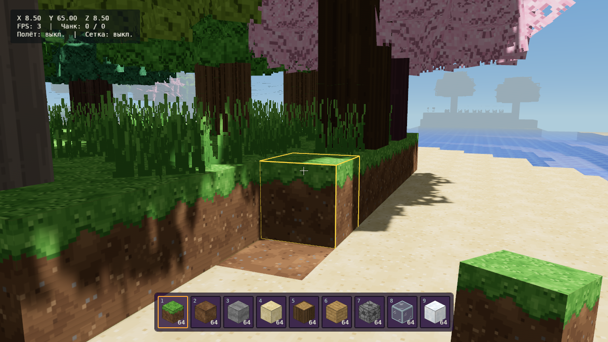
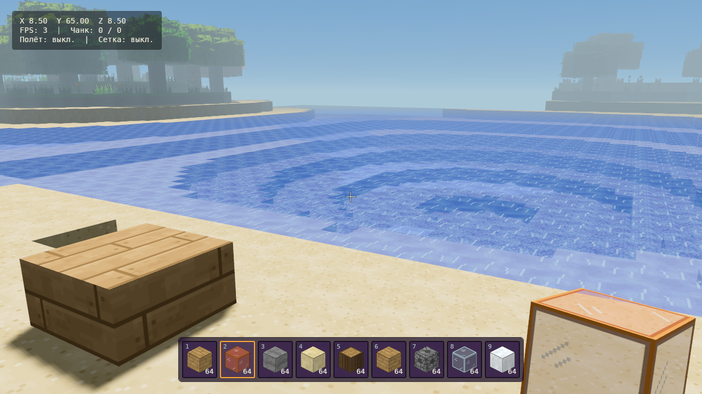

# Большая партия: 82 блока, плиты и генератор мира 5

Набор блоков идёт по списку Minecraft 1.20.1, графика каждого блока собственная (`tools/generate_pixel_art.py`). В игре 185 типов блоков (ID 0…184) и 263 предмета. Внутренний атлас — 216 слоёв (6×36).

## Новые блоки (ID 103…184)

- **Пять пород дерева** — акация, тропическое дерево, тёмный дуб, мангр, вишня: бревно, листва (объёмная), доски.
- **Руды** — медная, изумрудная, лазуритовая; блоки меди, изумруда, лазурита. Предметы: сырая медь, медный слиток, изумруд, лазурит.
- **Цветное стекло** — 16 цветов, полупрозрачное.
- **Цветная терракота** — 16 цветов.
- **Природные и декоративные** — губка, арбуз, тыква, сноп сена, костный блок, грязь, утрамбованная грязь, грязевые кирпичи, мох, подзол, каменистая земля, красный песок, красный песчаник, кальцит, туф, аметистовый и кварцевый блоки.
- **Плиты** — 12 материалов: дуб, берёза, сосна, камень, булыжник, каменные кирпичи, гладкий камень, песчаник, кирпич, гранит, мрамор, тёмные кирпичи.

## Плиты и физика

Плита занимает нижнюю половину клетки: рисуется половинным блоком, на неё встают на высоте полблока, над ней остаётся полблока свободного места. Столкновения считаются в полублоках по вертикали; для обычных блоков поведение не изменилось. Рецепт: три блока в ряд → 6 плит.

## Рецепты

- Доски из брёвен новых пород; блоки меди, изумруда и лазурита из 9 предметов и обратно.
- Цветное стекло и цветная терракота: 8 блоков вокруг красителя → 8 цветных.
- Грязь: земля + вода; утрамбованная грязь: грязь + высокая трава; грязевые кирпичи: 2×2; каменистая земля: земля и гравий в шахматном порядке; сноп сена: 9 высокой травы; красный песчаник: 2×2 красного песка.
- Печь: сырая медь и медная руда → слиток; красный песок → стекло; грязь → глина; новые брёвна → уголь, листва → зелёный краситель.

## Генератор мира 5

Новые миры получают поверх генератора 4: вишни, акации, тёмные дубы, тропические деревья и мангры (часть обычных дубов), гнёзда медной, лазуритовой и изумрудной руды, красный песок в пустынях, редкие тыквы и арбузы. Миры генераторов 1–4 не меняются.

## Проверки

283 автотеста, `clippy -D warnings`, `fmt`. В запущенной release-сборке: новый мир с вишней, соснами и травой; плита поставлена и рисуется половинкой блока; цветное стекло прозрачное в руке; каталог показывает новые блоки.

**Не проверено в игре:** ходьба по плитам (только автотестом физики), новые руды под землёй, рецепты.

## Что осталось от списка

Сделано около пятой части списка, если считать по записям; по сути остались в основном некубические и «механические» семейства:

- ступени, заборы, стены, двери, люки, калитки, панели стекла, ковры, кровати, факелы, лестницы, рельсы — нужны состояния поворота и собственные формы столкновений;
- верхние и двойные плиты; значок плиты в каталоге пока рисуется целым кубом;
- жидкости с течением, огонь, посевы и рост растений, саженцы;
- редстоун-механизмы, поршни, раздатчики, воронки;
- блоки других измерений и уникальные изобретения Minecraft — их стоит заменять своими.

Технический потолок: ID блока — один байт, свободно 71 значение. Для остального списка нужно перейти на двухбайтные ID и хранить состояние блока (поворот, половина, открыт/закрыт).
