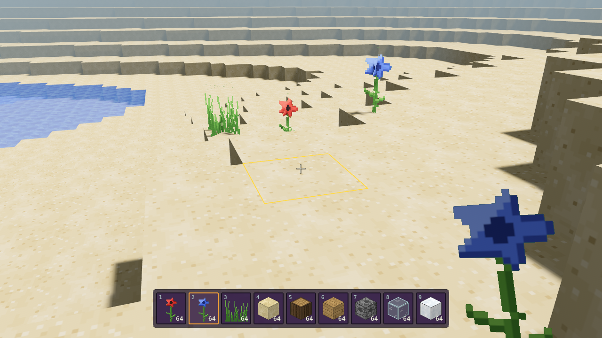
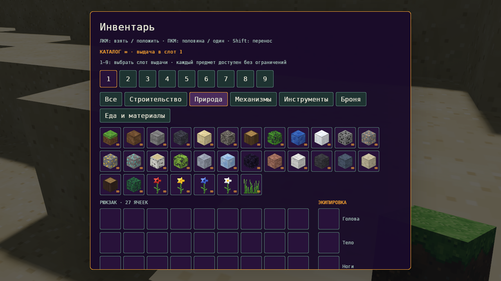

# Обновление «Флора»: растения, красители и генератор мира 4

Набор блоков идёт по списку Minecraft 1.20.1 партиями; графика каждого блока — собственная, из `tools/generate_pixel_art.py`. В игре 103 типа блоков (ID 0…102) и 177 предметов.

## Растения — первые некубические блоки

Мак, одуванчик, василёк, ромашка и высокая трава (ID 98…102) рисуются двумя скрещёнными плоскостями со случайным сдвигом, не мешают ходьбе и отбрасывают тень по контуру. В каталоге и в руке показываются плоским значком. Блок, поставленный на растение, заменяет его. Высокая трава при сборе ничего не даёт.

## Красители

16 красителей (предметы):

- из цветов: мак → красный, одуванчик → жёлтый, василёк → синий, ромашка → белый (по 2 штуки);
- уголь → чёрный; листва в печи → зелёный;
- смешивание двух красителей рядом (слева направо): красный+жёлтый → оранжевый, красный+синий → фиолетовый, зелёный+синий → бирюзовый, синий+белый → голубой, зелёный+белый → лаймовый, красный+белый → розовый, чёрный+белый → серый, серый+белый → светло-серый, фиолетовый+розовый → пурпурный, красный+зелёный → коричневый.

Окраска: белая шерсть + краситель → цветная шерсть; песок + гравий + краситель в ряд → 2 бетона. Теперь цветные блоки добываются в выживании.

## Генератор мира 4

Новые миры получают поверх генератора 3:

- сосны — каждое третье дерево;
- линзы пород в камне: известняк, гранит, мрамор, сланец; базальт в глубинном камне;
- цветочные поляны (вид цветка зависит от местности) и высокую траву на дёрне.

Миры генераторов 1–3 открываются своим генератором без изменений.

## Проверки

280 автотестов, `clippy -D warnings`, `fmt`. В запущенной release-сборке растения поставлены из каталога и отрисованы с вырезанным контуром и тенями; значки и вид в руке проверены.

**Не проверено в игре:** генерация мира 4 (сосны, породы, поляны) — только автотестом; крафт красителей и окраска — только проверкой рецептов.

## Ограничения

- Растение не исчезает, если убрать блок под ним.
- Плиты, ступени, заборы и двери по-прежнему не сделаны: им нужны неполные столкновения в физике игрока.
