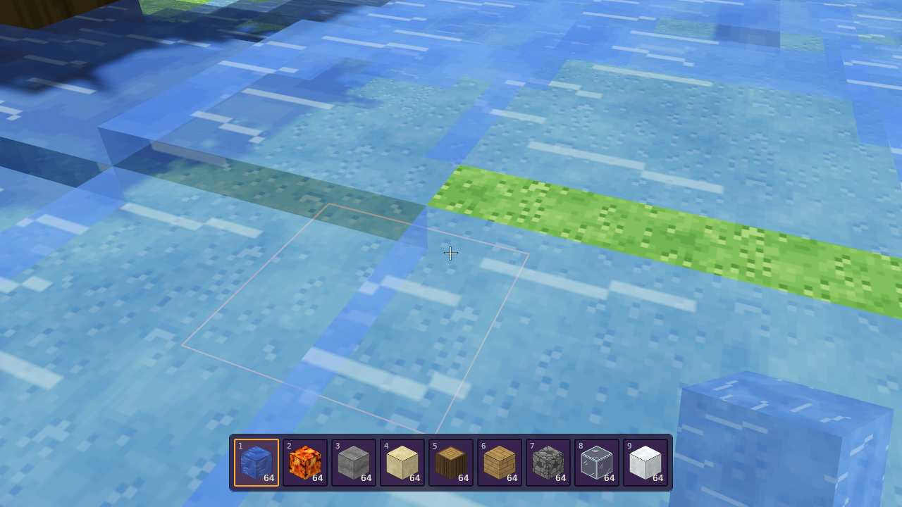
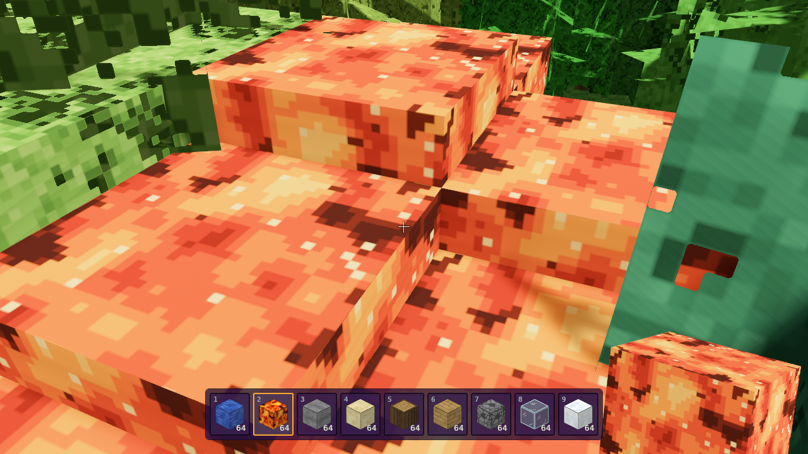
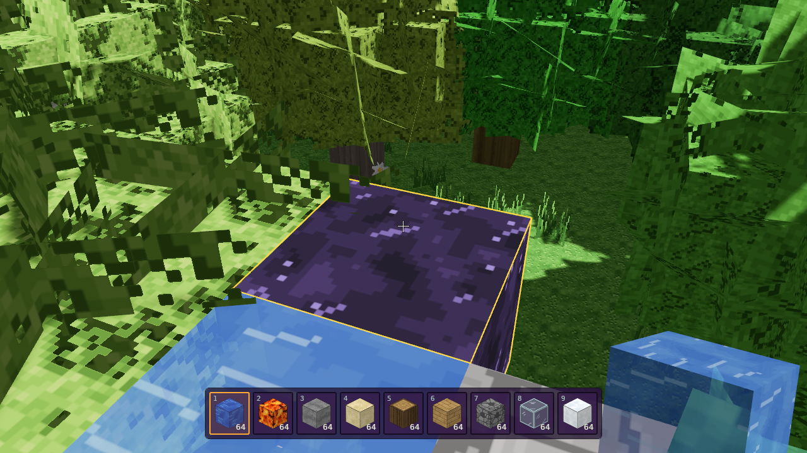

# Обновление «Жидкости»: физика воды и лавы

## Как течёт жидкость

Состояние жидкости хранится в ID блока, поэтому сохранения и сеть не требуют ничего нового:

| | Источник | Течение | Дальность | Шаг |
|---|---|---|---|---|
| Вода | `WATER` (уровень 8) | 7 уровней (`FLOW_WATER_1…7`) | 7 клеток | 0,25 с |
| Лава | `LAVA` (уровень 4) | 3 уровня (`FLOW_LAVA_1…3`) | 3 клетки | 1,5 с |

Правила (`crates/game_core/src/fluids.rs`):

- Жидкость сначала падает вниз; растекается вбок, только когда под ней опора. Падающая струя вбок не течёт.
- Каждая клетка течения держится, пока ей есть что питать: источник рядом или жидкость сверху. Убрали источник — вся вода сходит.
- Два источника воды рядом при опоре снизу порождают третий (бесконечная вода). У лавы такого нет.
- **Вода + лава:** вода, дотекшая до источника лавы, даёт обсидиан; до течения лавы — булыжник. Лава, дотекшая до воды, застывает камнем.
- Жидкость не входит в незагруженные чанки и заменяет только воздух и растения.
- Расчёт событийный: клетки «просыпаются», когда рядом меняется блок, и обрабатываются порциями (до 768 за шаг). Океан, созданный генератором, ничего не считает, пока вы не откроете в нём проём.
- Правки жидкости сохраняются вместе с остальными правками мира; при загрузке они «успокаиваются».

## Что видит и чувствует игрок

- **Рендер.** Течение рисуется блоком с высотой по уровню; ступеньки между уровнями показываются полоской. Лава светится, свечение повторяет рисунок текстуры.
- **Плавание.** В воде ходьба медленнее, тело мягко тонет, пробел — вверх, Shift — вниз, у поверхности пробел выталкивает на берег. Течение сносит.
- **Лава.** Замедляет сильнее, жжёт (урон и горение из правил выживания), под ней можно только медленно выплыть пробелом.
- **Пелена.** Под водой экран синеет, в лаве — краснеет.
- **Падение в воду** гасит урон от падения.
- **Прицел** смотрит сквозь жидкости: можно копать и ставить блоки под водой. Блок, поставленный в воду, вытесняет её.
- **Мобы** гибнут в лаве без добычи и не заходят в воду и лаву во время прогулки.

## Вёдра

| Предмет | Как получить | Что делает |
|---|---|---|
| Ведро | 3 железных слитка «V» | ПКМ по источнику воды или лавы набирает его |
| Ведро воды / лавы | наполнить | ПКМ выливает источник в клетку у стены или в клетку с течением |

Течение набрать нельзя. С ведром в руке прицел видит жидкости; в Creative левая кнопка с ведром стирает любую жидкость. Лава как блок есть в каталоге Creative («Природа»).

## Проверки

301 автотест, `clippy -D warnings`, `fmt`. В запущенной release-сборке: вода растекается по земле ромбом на 7 клеток; лава течёт ступенями на 3 клетки; вода рядом с лавой даёт обсидиан и камень; блоки видны сквозь воду.

**Не проверено вручную:** ощущения от плавания, пелена под водой и в лаве, урон от лавы в Survival, вёдра в руках, перенос потоков через сохранение, нагрузка при больших наводнениях. Всё это покрыто только тестами логики.

## Ограничения

- Течения не делают звуков брызг; у воды и лавы нет анимации поверхности.
- Свет лавы не освещает окрестные блоки — светится только она сама.
- Лава не поджигает, не плавит и не взаимодействует с растениями, кроме вытеснения.
- Уровни воды не сглаживаются по углам, у соседних клеток высота «ступенчатая».
- Затопление через проём в океане ограничено порцией на шаг, большие объёмы заполняются постепенно.
