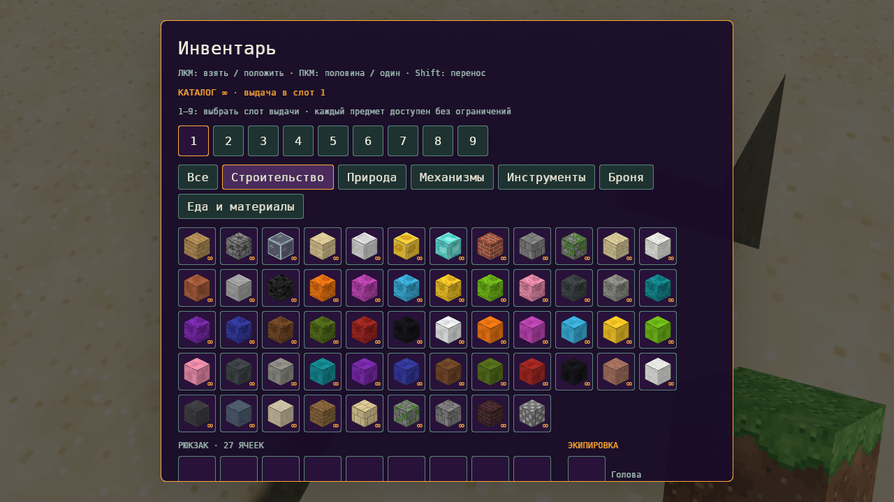

# Обновление «Палитра»: 49 декоративных блоков

Всего в игре теперь 98 типов блоков (ID 0…97), в каталоге 156 предметов. Внутренний атлас расширен до 144 слоёв (6×24).

## Новые блоки (ID 49…97)

- **Крашеная шерсть** — 15 цветов (белая была раньше).
- **Бетон** — 16 цветов.
- **Породы камня** — гранит, мрамор, базальт, сланец, известняк и их полированные версии.
- **Сосна** — бревно, хвоя, доски.
- **Кладки** — кирпичи из песчаника, замшелые и потрескавшиеся каменные кирпичи, тёмные кирпичи, каменная плитка.

Все текстуры нарисованы генератором `tools/generate_pixel_art.py`.

## Как получить

- В Creative — вкладки «Строительство» и «Природа».
- Полированный камень: 2×2 на верстаке или камнерез. Кирпичи из песчаника и каменная плитка: 2×2 или камнерез. Потрескавшиеся кирпичи: камнерез. Замшелые: кирпичи + листва. Тёмные кирпичи: кирпичи в печи. Сосновые доски: из бревна.
- **Только в Creative:** крашеная шерсть и бетон (красителей в игре нет), сами породы камня и сосна (в генерации мира их пока нет).

## Почему не «все блоки Minecraft 1.20.1»

- Полный список из 1003 блоков с их названиями и видом — это содержимое чужой игры; копировать его целиком я не стал. Добавлены общие материалы с собственной графикой.
- Больше половины того списка — не кубы: ступени, плиты, заборы, двери, растения, редстоун, рельсы, таблички. Мешер Voxium строит только полные кубы; для таких форм нужны модели блоков, состояния и повороты.
- ID блока хранится в одном байте: максимум 256 типов.

## Проверки

278 автотестов, `clippy -D warnings`, `fmt`. В запущенной release-сборке открыта вкладка «Строительство», поставлены блоки шерсти, блок показан в руке.

