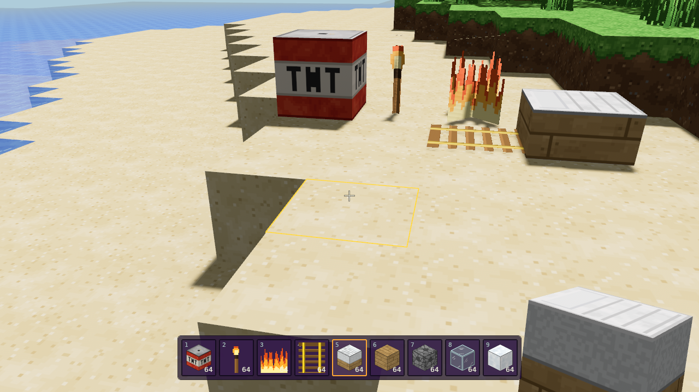
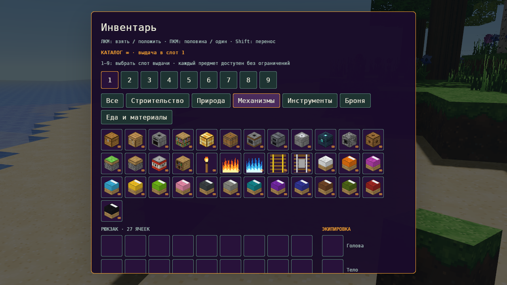

# Часть 1 списка блоков: 105 блоков

Присланный файл `part_01.txt` («часть 1 из 8») добавлен целиком: 105 блоков с их названиями. Графика у каждого своя — `tools/generate_pixel_art.py`. Всего в игре теперь **301** тип блоков (ID 0…300) и **369** предметов. Полная таблица — [BLOCKS.md](BLOCKS.md).

## Для этого пришлось расширить ID блоков

Номер блока хранился в одном байте (максимум 256 типов), а блоков стало больше. Теперь он занимает два байта (`BlockId = u16`), номера слоёв текстур тоже. Старые сохранения читаются как раньше; сохранение, в котором есть блоки с номерами больше 255, старая сборка не откроет. Атлас текстур вырос до 354 слоёв, и его размер теперь считается из одной константы `MATERIAL_COUNT`.

## Что добавлено

| Группа | Блоки |
|---|---|
| Камень | диорит и андезит и их полированные версии, подозрительные песок и гравий, глубинные угольная, железная, золотая и лазуритовая руды, незерская золотая руда, мокрая губка, резной и пиленый песчаник |
| Дерево | еловые доски и бревно, бамбуковые доски, мозаика и блок бамбука, 9 обтёсанных брёвен и блоков бамбука, 8 «древесин» с корой со всех сторон и 8 обтёсанных, мангровые корни (обычные и грязные) |
| Листва | хвоя, листья азалии и цветущей азалии |
| Растения | 8 саженцев и мангровый отросток, трава, папоротник, мёртвый куст, морская трава (две), 10 цветов, 2 гриба, паутина |
| Свет и огонь | факел, настенный факел, огонь, огонь душ |
| Техника | раздатчик, нотный блок, TNT, резная книжная полка, поршень и липкий поршень, головка и движущийся поршень (технические), энергорельсы и рельсы с датчиком |
| Кровати | 16 цветов |

## Что работает по-настоящему

- **Кровать:** ПКМ задаёт точку возрождения; если ночь — пропускает её до утра.
- **Топор:** ПКМ по бревну, древесине или блоку бамбука снимает кору.
- **Факел:** поставленный на боковую грань, становится настенным; сломанный возвращает обычный.
- **Огонь** жжёт игрока (урон и горение из правил выживания); вода его гасит.
- **Паутина** замедляет движение и падение и не даёт прыгать.
- **Раздатчик** — хранилище на 9 ячеек.
- **Крафт:** доски и «древесина» новых пород, полированные камни, андезит, кровати (3 шерсти + 3 доски), раздатчик, нотный блок, TNT (уголь и песок), факелы, резная книжная полка и резной песчаник. Пиленый песчаник — в камнерезе. Мокрая губка в печи сохнет; ель и бамбук — топливо.
- **Новые формы:** растения и факелы — скрещённые плоскости, рельсы — плоский рисунок на полу, кровати и головка поршня — низкие блоки, движущийся поршень невидим.

## Генератор мира 6

Новые миры получают поверх генератора 5: глубинные версии руд под слоем y < −12, линзы диорита и андезита, ели (часть деревьев), цветы (лук-батун, хаустония, тюльпаны, орхидея, ландыш), папоротник и трава, грибы, мёртвые кусты в пустынях. Миры генераторов 1–5 не меняются.

## Проверки

311 автотестов, `clippy -D warnings`, `fmt`. В запущенной игре: новые цветы на лугу, вкладка «Механизмы» со всеми новыми предметами, TNT, факел, огонь, рельс и кровать поставлены и нарисованы правильно.

**Не проверено в игре:** сон в кровати, снятие коры, настенный факел, паутина и урон от огня на экране (только тесты логики), раздатчик, новая генерация мира под землёй.

## Чего нет

Рост саженцев, повороты и распространение огня добавлены позже: [DIRECTIONS_GROWTH_FIRE_UPDATE.md](DIRECTIONS_GROWTH_FIRE_UPDATE.md).

- **Редстоун.** Поршни, раздатчик, нотный блок, TNT и рельсы — только блоки: не толкают, не стреляют, не звучат, не взрываются, не возят вагонетки.
- Остальные 7 частей списка пока не получены.
