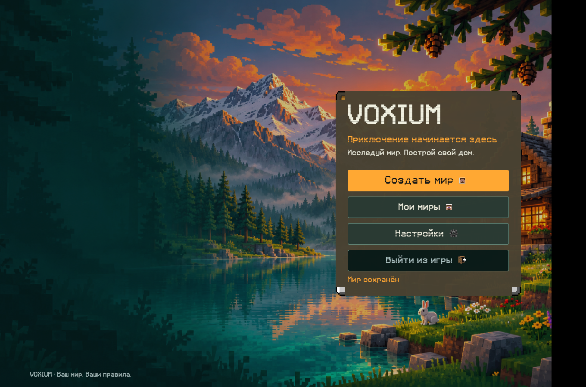
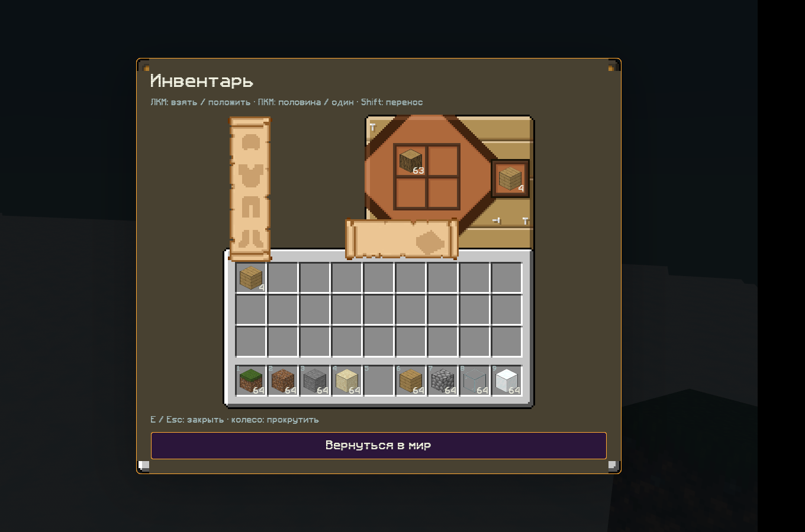

# Пользовательские ресурс-паки

Основа: BASE-1, коммит `19908c9b7859b617fdb6f1352d2d54fc5bd099d0`, PR #8.

## Подключено

- Better Dogs V0.41: 12 вариантов волка/собак, свои модели, текстуры и ходьба.
- Blue’s Better Skeletons: четыре варианта скелета.
- Boss Refreshed: дракон Края и визер, геометрия, текстуры и светящиеся области.
- Better Farm Animals: корова, свинья, овца, курица, кролик, муухомор.
- Blue’s Better Monsters: зомби, крипер, кадавр, утопленник, странник Края, паук, ведьма, визер-скелет и зомби-житель.
- Всего 49 вариантов для 19 видов. Выбор варианта стабилен для ID моба.
- Spawned Eggs: 88 PNG; существующие в каталоге яйца получают отдельные рисунки. Отсутствующие виды не добавляются в игру только ради картинки.
- Faithful 32×: 650 из 734 тайлов атласа; шрифт на основе присланных растровых таблиц, включая кириллицу. 84 тайла сохраняют прежнюю графику, когда соответствующего изображения нет в паке. Точные списки — `assets/resource_packs/manifest.json`.
- Icons: значки кнопок начального меню.
- Colourful Containers: графика инвентаря, верстака, печи, коптильни, плавильни, сундука и бочки с настоящими слотами поверх рисунка. Творческий каталог и остальные панели используют адаптированные рамки и слоты. Экипировка и личный крафт остаются доступны при открытом контейнере.
- Новое начальное меню VOXIUM с пиксельным шрифтом, крупными действиями, значками и прокруткой для небольшого окна.

## Запуск и повторный импорт

Все необходимые игровые ресурсы встроены в бинарник. Для обычной сборки не нужны Python и исходные ZIP:

```sh
cargo run --release --locked -p voxel-client
```

В настройках «Графика блоков → Faithful 32×» включена по умолчанию; переключение возвращает исходный рисованный набор.

Для повторной конверсии положите девять исходных архивов в отдельный каталог. Нужны Python 3, Pillow, numpy и fontTools:

```sh
python3 tools/import_resource_packs.py --source-dir /path/to/packs
python3 -m unittest discover -s tools -p test_import_resource_packs.py
cargo fmt --all
```

PNG выбираются из архивов адресно; содержимое архивов не исполняется. Контрольные суммы ZIP, использованные пути, модели и запасные тайлы записаны в манифест. Исходные выбранные JEM и метаданные/указания авторства сохранены в `assets/resource_packs/sources/`. Таблица символов соответствует сетке Minecraft 1.20.1; три отсутствующих служебных знака взяты из уже поставлявшегося DejaVuSansMono.

## Границы адаптации

Это адаптация присланных ресурсов для Bevy. OptiFine не требуется. Геометрия, UV, иерархия и исходные повороты переносятся; ограниченный числовой интерпретатор выбирает начальную видимость и масштабы. Он не использует Python eval/exec. Движение головы, конечностей, хвоста и крыльев выполняет родная система анимации Voxium. Произвольные анимации OptiFine, условия по именам/биомам, морфинг, приручение и новые способности боссов не добавлены.

Два присланных архива «База Алекса.zip» превышают лимит передачи инструмента 32 МиБ и не прочитаны. Эта работа основана на исходниках PR #8 и девяти доступных ресурс-паках.

Ресурсы принадлежат авторам соответствующих паков; проект не объявляет их собственной графикой. Старые Windows ZIP в `dist/` не пересобраны этим изменением.

## Проверки

- `cargo fmt --all -- --check` — успешно.
- `cargo check --workspace --locked` и `cargo clippy --workspace --all-targets --locked -- -D warnings` — успешно.
- `cargo test --workspace --locked` — 394 теста Rust, ошибок нет.
- `python3 -m unittest discover -s tools -p test_import_resource_packs.py` — 10 тестов импортера, ошибок нет. Проверены преобразования координат, иерархия, прозрачность, безопасные выражения и координаты слотов.
- В запущенной Linux-сборке проверены начальное меню, загрузка мира, новый инвентарь, перенос предметов и крафт: одно бревно расходуется, четыре доски переходят в рюкзак. Проверены прокрутка инвентаря и возврат в мир; осмотрены текстуры блоков, творческий каталог и модель коровы.
- Замечания независимого просмотра кода исправлены и повторно проверены: порядок поворотов, исходные положения суставов, скрытая альтернативная геометрия, роли ног паука, окраска листвы и попадание в слоты.

Проверки выполнены Rust 1.99.1 в Xvfb с программным Vulkan (Mesa lavapipe). Отладочная информация и инкрементальная сборка отключены из-за дисковой квоты среды; для `game_render` использован локальный профиль с `opt-level = 2`. Файлы зависимостей проекта не изменены. Это проверка работоспособности, а не замер производительности на игровом GPU. Звукового устройства в среде нет. Windows-сборка не проверялась.

## Скриншоты проверенной сборки

Начальное меню:



Инвентарь после переноса четырёх скрафченных досок в рюкзак:


