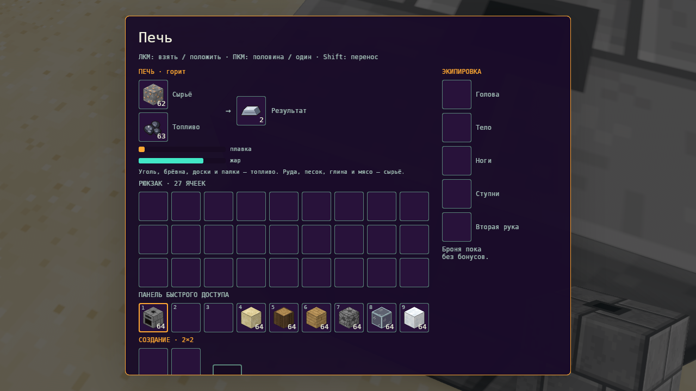
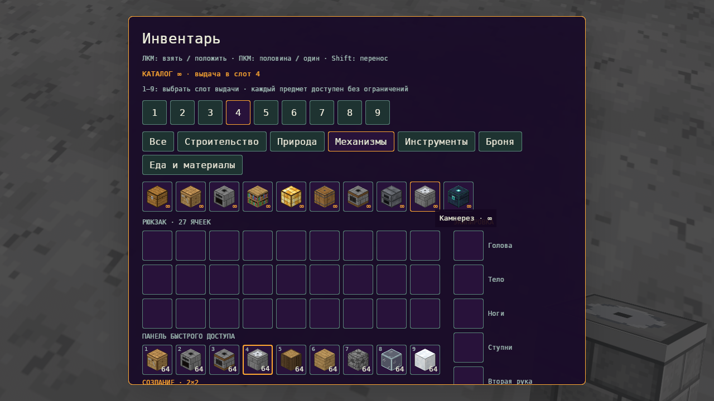

# Обновление «Мастерская»: функциональные блоки и их меню

Основано на присланном ТЗ `18_functional_ui_requirements_ru.md`. Реализованы те интерфейсы, для которых в игре уже есть нужные механики; оформление собственное.

## Что работает

| Блок (ID) | Меню и функция | Рецепт на верстаке |
|---|---|---|
| Сундук (16) | 27 ячеек | 8 досок кольцом |
| Бочка (42) | 27 ячеек | доски по бокам, палки сверху и снизу |
| Общий сундук (48) | 27 ячеек, одно хранилище на все такие блоки; разрушение блока не высыпает содержимое | 8 обсидиана вокруг алмаза |
| Верстак (24) | сетка 3×3, результат, Shift — всё | 4 доски |
| Печь (25/41) | сырьё, топливо, результат, полосы плавки и жара | 8 булыжника кольцом |
| Коптильня (43/44) | как печь, но только еда и вдвое быстрее | печь и 4 бревна крестом |
| Плавильня (45/46) | как печь, но только руда и сырой металл, вдвое быстрее | 5 железа, печь, 3 гладких камня |
| Камнерез (47) | ячейка сырья и кнопки вариантов, обмен один к одному | железо над тремя камнями |

Камнерез режет: камень → каменные кирпичи / гладкий камень / булыжник; булыжник → гравий / замшелый булыжник; каменные кирпичи и гладкий камень → обратно; песчаник и гравий → песок; глубинный камень → булыжник; кирпичи → терракота.

Коптильня и плавильня меняют текстуру, пока горят, и вдвое быстрее расходуют топливо. В Creative при открытом блоке его меню стоит первым, каталог уходит ниже.

## Проверки

- 278 автотестов, `clippy -D warnings`, `fmt`.
- В запущенной release-сборке (Xvfb, программный Vulkan) открыты меню верстака, печи, коптильни и камнереза; в печи переплавлена железная руда на угле: слитки появились, полосы плавки и жара двигались.

**Не проверено в игре:** бочка, общий сундук, плавильня и сама резка камнерезом — только автотестами.

## Что не сделано и почему

- **Графика из присланных архивов не встроена.** RAR — ресурспак Minecraft (блоки, предметы, мобы), а 18 PNG — экраны интерфейса Minecraft. Это чужая графика, поэтому меню и блоки нарисованы в стиле Voxium.
- **Двойной сундук на 54 ячейки** — пока каждый сундук отдельный.
- **Наковальня, точило, стол зачарований, стол кузнеца, зельеварка, маяк, стол картографа, ткацкий станок, шалкеровый ящик** — им нужны системы, которых в игре ещё нет: прочность и чары, зелья и эффекты, карты, узоры, предметы с содержимым. Меню без механики было бы пустышкой.
- Содержимое всех контейнеров по-прежнему не сохраняется между запусками.
